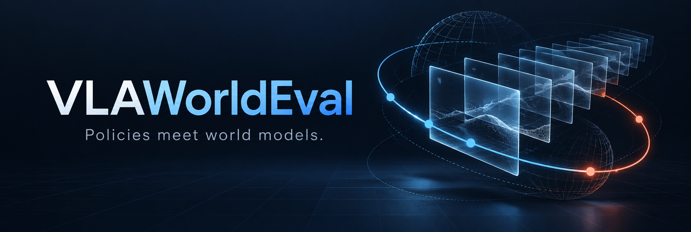
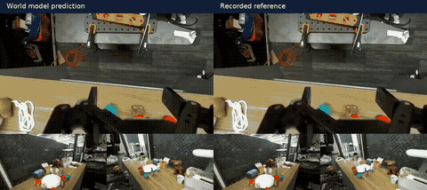
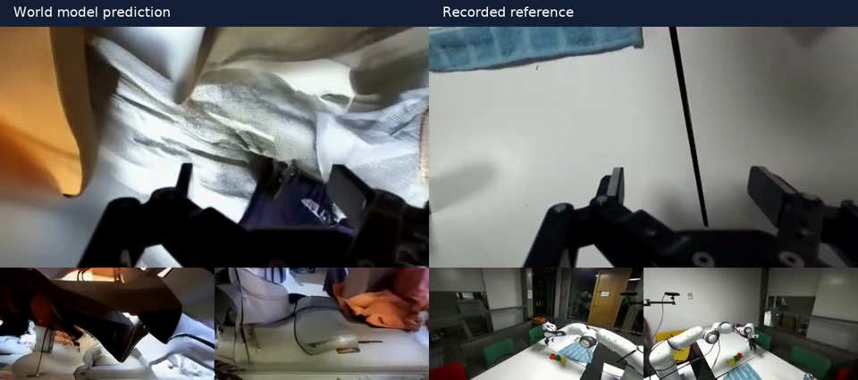
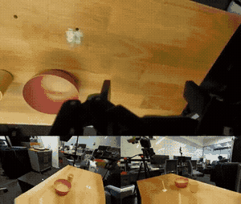
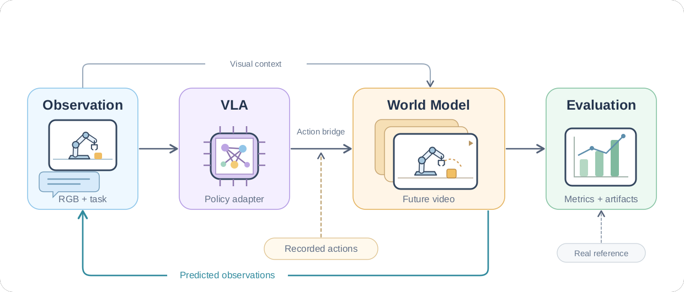

<p align="center">
  
</p>

<p align="center">
  <a href="README.md">English</a> · <a href="https://liu-ming-hua.github.io/VLAWorldEval/zh/README.html">在线使用手册</a> ·
  <a href="#模型组合">模型组合</a> · <a href="#原生域参考结果">参考结果</a> ·
  <a href="CONTRIBUTING.md">参与贡献</a>
</p>

<p align="center">
  <a href="LICENSE"></a>
  
  
  
</p>

# VLAWorldEval

**连接机器人策略、动作条件世界模型与可复现评估的统一框架。**

[在线使用手册](https://liu-ming-hua.github.io/VLAWorldEval/zh/README.html) · [Documentation website](https://liu-ming-hua.github.io/VLAWorldEval/)

既可以让 VLA 使用生成观测进行自回归闭环，也可以绕过 VLA，直接回放真实动作。
模型依赖独立管理，动作语义显式声明，视频、动作数组与来源信息一起保存。
面向机械臂与夹爪任务，不承诺任意模型之间都能直接组合。

**我们的愿景：** 随着世界模型对机器人动作的响应更加准确，让可复现、可扩展的 VLA 闭环评测成为真实机器人测试的实用补充。

> [!IMPORTANT]
> 世界模型可能在生成逼真视频的同时忽略动作、幻觉交互或发生长程漂移。
> 适配器能运行，不代表物理正确、真机任务成功或 VLA 排名可信。
> 请先在 checkpoint 的原生动作与观测域验证。[如何解读结果 →](docs/zh/reliability.md)

## 实际生成演示

<p align="center">
  <a href="docs/assets/demos/cosmos-droid-task.mp4">
    
  </a>
</p>

<p align="center">
  <b>任务：将瓶子与橙色毛绒玩具放到白色盘子上</b><br>
  Cosmos DROID FD · 64.1 秒 · 60 次自回归生成 · 原始 15 FPS<br>
  <sub>左侧：生成未来。右侧：真实执行。未减速、拼接不同轨迹或重复播放。<br>
  这是使用真实动作的 WM 回放，不是 VLA 成功闭环。点击查看完整连续 MP4。
  <a href="docs/assets/provenance.json">查看素材来源</a></sub>
</p>

<details>
<summary>长程回放：2 分 19 秒，130 次自回归生成</summary>

[](docs/assets/demos/cosmos-droid-long.mp4)

任务：“将积木移到左边，然后整理布料”。完整保存的 138.7 秒轨迹按原始 15 FPS 播放。
左侧为生成未来，右侧为真实未来；长程预测误差如实保留，没有剪掉失败段落。

</details>

<details>
<summary>另看 VLA 闭环：GR00T N1.5 × Cosmos，21.4 秒</summary>

[](docs/assets/demos/groot-cosmos.mp4)

指令：“将黄色杯子里的东西倒入碗中”。生成观测会反馈给策略继续推理。
这是更长的连续闭环，尚不能标为已验证的任务成功示例。

</details>

## 框架流程

<p align="center">
  <a href="docs/assets/framework.svg">
    
  </a>
</p>

[查看可编辑 SVG 框架图](docs/assets/framework.svg)

| 模块 | 提供什么 |
| --- | --- |
| 模型适配器 | VLA 与 WM 分离，复用各模型官方加载和推理实现 |
| 协议契约 | 明确视角、动作表示、归一化、历史窗口、控制与视频频率 |
| 独立 Worker | uv 环境隔离、模型常驻，以及显式声明的多卡推理能力 |
| 两条评估入口 | VLA × WM 自回归闭环；真实动作回放与真实未来对照 |
| 可复现产物 | 连续多视角视频、原生及转换动作、耗时、失败记录与校验信息 |
| 可扩展评价 | 图像指标、冻结首帧基线、覆盖率及域限定的运动诊断 |

## 快速开始

需要 Linux、Python 3.11、[uv](https://docs.astral.sh/uv/) 与 FFmpeg。
核心环境不安装 Torch、JAX、TensorFlow 或模型权重。

```bash
bash scripts/setup/core.sh
environment/core/bin/python -m cli demo --output results/first_demo --chunks 30
environment/core/bin/python -m cli inspect --artifact results/first_demo
```

该 demo 是合成集成样例，不代表预训练模型效果。准备好[环境与资产](docs/zh/installation.md)后，先检查配置，再显式执行：

```bash
environment/core/bin/python -m cli evaluate \
  --config configs/experiments/openvla_worldgym_v1.json \
  --experiment loop_smoke --check-only

# 先通过 configure 选择 GPU 和显存预算，再执行：
environment/core/bin/python -m cli evaluate \
  --config configs/experiments/openvla_worldgym_v1.json \
  --experiment loop_smoke --execute
```

安装与下载脚本关闭代理，使用可配置的 PyPI/HF 镜像。
GitHub、Google Drive、GCS 资源仍按实际官方托管位置与权限获取。

[第一个真实闭环 →](docs/zh/quickstart.md) · [真实动作评估 →](docs/zh/workflows.md)

## 模型组合

当前运行注册表包含 **16 条显式组合配置**。B 为基础支持路径，E 为依赖特定机器人转换的实验路径，
— 为没有注册组合。这里描述的是接入范围，不是安装就绪情况或物理可靠性认证。

| VLA / checkpoint | WorldGym · Bridge | Cosmos · DROID EEF FD | Ctrl-World · DROID |
| --- | :---: | :---: | :---: |
| OpenVLA | B | — | — |
| SpatialVLA | B | — | — |
| Octo | B | — | — |
| RT-1-X | B | — | — |
| GR00T N1.5 · OXE-DROID | — | B | E |
| GR00T N1.7 · base | — | E | E |
| GR00T N1.7 · DROID | — | E | E |
| π0 · DROID | — | E | E |
| π0.5 · DROID | — | E | E |
| π0-FAST · DROID | — | E | E |

需要机器人状态的策略仍必须获得有效输入；仅输出视频的 WM 不会自动提供状态。
DROID 路径有显式、受假设约束的转换，不能视为测得的未来状态。
Cosmos EEF FD 路径使用的是 **community 20k-EMA checkpoint**，不是 Nano 通用底座。

模型目录还包括 SmolVLA、Cosmos Policy、DreamZero、A2World、GE-Sim 2.0、τ₀-WM、
DreamDojo、IWS、PlayWorld、DreamTrue、IRASim 与 Giga-World-1。
各模型原生协议和就绪状态不同，登记适配器不等于具备任意 VLA 配对能力。

[输入输出与训练域 →](docs/zh/models.md) · [如何选择组合 →](docs/zh/compatibility.md)

## 原生域参考结果

已有运行的配对预测指标，**不是跨域排行榜**。LPIPS 越低、SSIM 越高表示图像更接近，不代表物理正确。

| 公开 checkpoint | 评价数据域 | 独立轨迹数 | 未来帧数 | SSIM ↑ | LPIPS ↓ |
| --- | --- | ---: | ---: | ---: | ---: |
| Cosmos DROID FD · community 20k EMA | DROID | 400 | 16–2704 | 0.301–0.951* | 0.151–0.723* |
| IRASim · Language-Table | Language-Table | 400 | 15–49 | 0.826–0.869* | 0.151–0.191* |
| DreamDojo · 2B GR1 | GR1 in-lab | 100 | 48 | 0.733 | 0.239 |
| IWS · PushT camera 1 | Real ALOHA PushT | 10 | 192 | 0.869 | 0.121 |
| Ctrl-World | 官方 DROID 子集 | 2 | 4 | 0.776 | 0.196 |
| WorldGym | 官方 Bridge test 样例 | 1 | 21 | 0.833 | 0.130 |

*区间为**不同预测长度分组的均值范围**，不是置信区间或挑选单样本极值。
Ctrl-World 的短窗口复用两条轨迹；WorldGym 是同一轨迹的三个种子。
数据域、时长和覆盖范围不同，不能据此给出总体排名或声称复现论文数值。

[指标定义与适用边界 →](docs/zh/reliability.md)

## 使用手册

| 开始使用 | 深入了解 |
| --- | --- |
| [快速开始](docs/zh/quickstart.md) | [模型协议与训练域](docs/zh/models.md) |
| [安装与镜像](docs/zh/installation.md) | [代码架构](docs/zh/architecture.md) |
| [运行与评价](docs/zh/workflows.md) | [新增适配器](docs/zh/extending.md) |
| [结果格式与查看](docs/zh/artifacts.md) | [排障指南](docs/zh/troubleshooting.md) |
| [English manual](docs/en/README.md) | [发布与许可边界](docs/zh/release.md) |

## 贡献与许可

保持适配器轻量、协议显式、执行过程共享。新增模型前请阅读 [CONTRIBUTING.md](CONTRIBUTING.md)。
原创框架代码采用 [MIT](LICENSE)，上游实现、权重、数据和派生演示素材遵循各自适用条款，详见[许可范围](LICENSE_SCOPE.md)。

## 致谢

感谢以下开源模型、数据集及工具的作者与维护者，使本框架的接入和评价工作成为可能：

- **策略模型：**[OpenVLA](https://github.com/openvla/openvla)、[SpatialVLA](https://github.com/SpatialVLA/SpatialVLA)、
  [Octo](https://github.com/octo-models/octo)、[Open X-Embodiment / RT-1-X](https://github.com/google-deepmind/open_x_embodiment)、
  [Isaac-GR00T](https://github.com/NVIDIA/Isaac-GR00T)、[OpenPI](https://github.com/Physical-Intelligence/openpi)、
  [LeRobot / SmolVLA](https://github.com/huggingface/lerobot)、[Cosmos Policy](https://huggingface.co/nvidia/Cosmos3-Nano-Policy-DROID)
  与 [DreamZero](https://huggingface.co/GEAR-Dreams/DreamZero-DROID)。
- **世界模型：**[WorldGym](https://github.com/world-model-eval/world-model-eval)、
  [Cosmos](https://github.com/NVIDIA/cosmos)、[Ctrl-World](https://github.com/Robert-gyj/Ctrl-World)、
  [A2World](https://github.com/LogosRoboticsGroup/A2World)、[GE-Sim 2.0](https://github.com/AgibotTech/GE-Sim-V2)、
  [τ₀-WM](https://github.com/sii-research/tau-0-wm)、[Giga-World-1](https://github.com/open-gigaai/giga-world-1)、
  [IWS](https://github.com/WangYixuan12/interactive_world_sim)、[DreamDojo](https://github.com/NVIDIA/DreamDojo)、
  [IRASim](https://github.com/bytedance/IRASim)、[DreamTrue](https://github.com/brave-eai/DreamTrue)
  与 [PlayWorld](https://github.com/irom-princeton/open-world)。
- **数据与评价：**[DROID](https://droid-dataset.github.io/)、
  [Open X-Embodiment](https://github.com/google-deepmind/open_x_embodiment)、
  [EWMBench](https://github.com/AgibotTech/EWMBench) 与 [LPIPS](https://github.com/richzhang/PerceptualSimilarity)。

展示使用的 DROID FD 权重来自[社区 20k-EMA 版本](https://huggingface.co/jere-mybao/cosmos3-nano-droid-forward-dynamics)。
各上游项目保留其许可与署名；致谢不代表相关作者为本框架背书。
