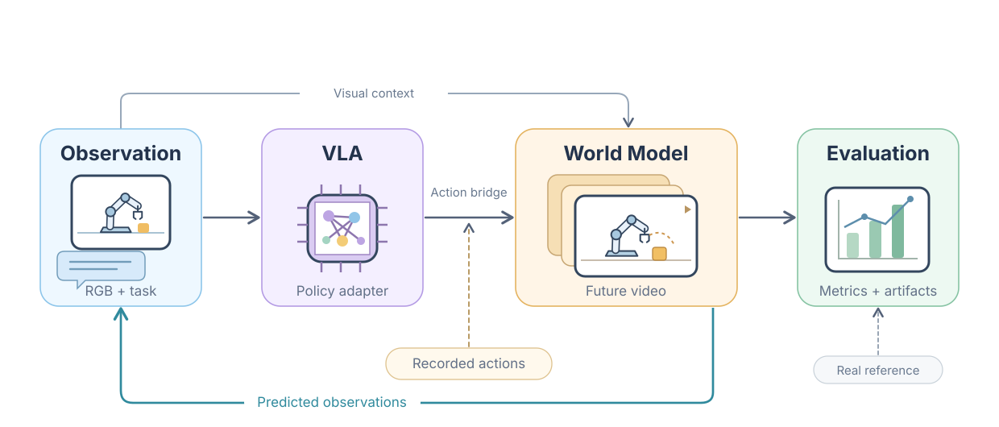

# 代码架构

[手册首页](README.md) / 架构 · [English](../en/architecture.md)



## 目录职责

| 目录 | 职责 |
| --- | --- |
| `adapters/vla/` | VLA 加载、原生输入组织与动作推理 |
| `adapters/world_models/` | 世界模型加载、reset、生成和历史管理 |
| `adapters/actions/` | 显式动作空间转换与运动学 |
| `adapters/observations/` | 相机拼接、拆分与具名视角映射 |
| `adapters/backends/` | 可选模型服务后端 |
| `evaluation/datasets/` | 轨迹发现、原生转换和真实未来隔离 |
| `evaluation/planning/` | 配对准入、schema 校验和冻结计划 |
| `evaluation/execution/` | Worker IPC、资源准入和闭环 / 回放调度 |
| `evaluation/reporting/` | 产物保存、视频诊断和指标报告 |
| `evaluation/validation/` | 离线校验、环境与分发包检查 |
| `cli/` | 参数、命令分发与结构化输出 |
| `vlaworldeval/` | 工作区、资产、缓存和包资源 |
| `configs/` | 模型目录、运行绑定、配对契约和配置模板 |
| `scripts/` | 安装、下载、原生输入准备与维护入口 |
| `environment/` | 环境注册、依赖、锁与本地 uv 环境 |
| `checkpoints/`、`datasets/` | 受保护输入资产，不是代码和清理对象 |
| `third_party/` | 独立获取的上游运行代码，不随框架分发 |
| `results/`、`.archive/` | 生成结果与可恢复本地归档，不随框架分发 |

## 模型边界

父进程管理计划、共享评价与产物生命周期，各模型在注册的独立解释器内运行。
Torch / JAX / TensorFlow 等可选库延迟导入，不在核心 CLI 启动时加载。
进程隔离用于避免不同模型的依赖冲突。

`client.py` 是父进程 IPC 接口，`worker.py` 是模型请求服务。
只有声明 reset 契约的模型才能跨轨迹复用权重；每条轨迹的图像历史与随机状态必须重置，
异常退出不能静默计作正常完成。

模型脚本仅准备原生输入，不另写一套评价循环；多卡可见性与进程清理由 Worker 管理。

## 协议边界

配对契约描述动作语义、相机身份、归一化、FPS 和历史规则。
桥接只能转换已知含义，不能制造物理真值。
视频 FPS、动作频率、扩散迭代和未来帧数是不同维度。

真实未来仅用于生成后评价。自回归必须反馈预测图像，不能悄悄注入 reference；
有意使用真实帧重锚定的诊断必须单独命名、单独报告。

## 公共 API

```python
from evaluation import ActionChunk, ObservationBundle, PairManifest, PolicyWorldModelEvaluator
```

优先使用公共导出与 CLI；内部模块可能调整。
[新增适配器](extending.md) · [产物格式](artifacts.md)
